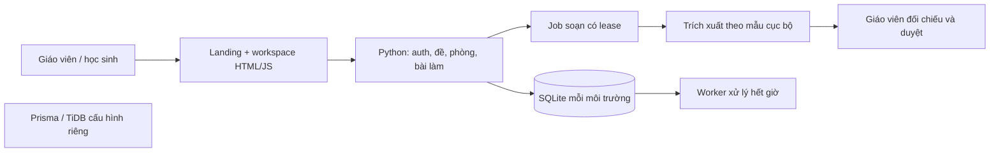
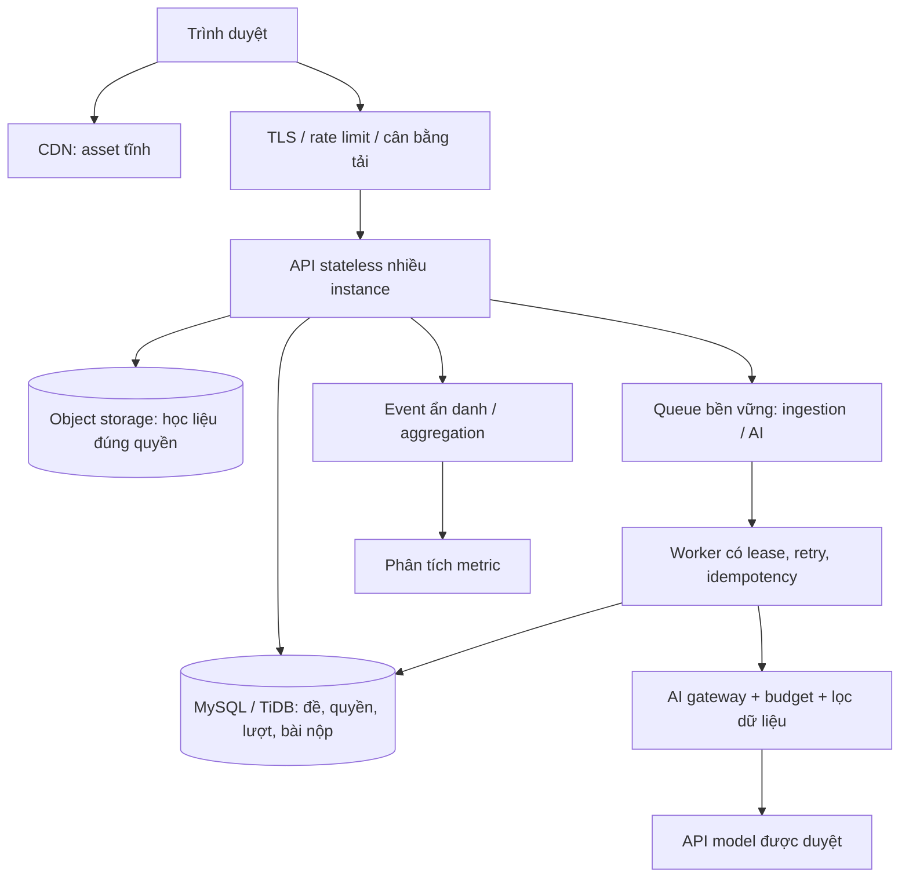

# Kiến trúc hiện tại và bài tập một triệu người dùng

Owner: Tùng; Ân/Tuấn review AI/job/adapter; Tùng chịu lifecycle/idempotency, Lý review giả định hành vi. Đây là hướng thiết kế dự kiến; **chưa triển khai hoặc kiểm thử ở quy mô một triệu người dùng**.

## Kiến trúc đang chạy được

Prisma/TiDB chưa nằm trên đường API runtime. Job đang trong SQLite; chưa có Redis, CDN production, object storage hay analytics pipeline thực. Server Python hiện phục vụ prototype, chưa là kết luận sẵn sàng vận hành thi thật.

## Đặt giả định trước khi chọn máy

Một triệu tài khoản đăng ký không đồng nghĩa một triệu em thi cùng lúc. Các số bên dưới chỉ minh họa phép tính, không phải dữ liệu đo hoặc mục tiêu doanh số.

| Biến giả định | Ví dụ để thiết kế |
|---|---:|
| Tài khoản đăng ký | 1.000.000 |
| Người dùng hoạt động/ngày | 50.000 |
| Lượt thi đồng thời tại đỉnh | 5.000 |
| Khoảng cách autosave trung bình | 5 giây |
| Request lưu bài ước tính | 5.000 / 5 = 1.000 request/giây |

Request lưu bài chưa gồm đăng nhập, mở đề, nộp cùng lúc, retry và event. Giai đoạn nộp bài phải có kịch bản spike riêng. Giả định này không dùng để suy ra số VPS; cần load test, profile transaction, kích thước đề, hành vi thật và ngân sách.

## Cấu trúc ứng viên khi số đo yêu cầu mở rộng

Các phần có thể giữ trong một modular monolith trước; tách worker AI vì thời gian và quota khác request làm bài. Tài liệu luôn qua kiểm tra quyền; biết URL object không tự cấp quyền. Cache được thêm theo số đo với chính sách invalidation, không giữ câu trả lời chưa nộp làm nguồn duy nhất ở RAM.

## Các nguyên tắc không đổi khi scale

- **Lưu/nộp bài:** source of truth bền vững, expected revision, idempotency key, deadline máy chủ, snapshot đề/mốc điểm và receipt nộp bài. Timeout phải được xử lý dù client đóng; không chỉ dựa vào timer trình duyệt.
- **AI:** async job, timeout/quota/backpressure, retry có giới hạn, quan sát theo request ID; không tự fallback gửi tài liệu qua nhà cung cấp khác. Review của giáo viên vẫn là bước chốt.
- **Queue:** chuẩn bị cho giao lặp; worker xử lý idempotent. Ví dụ [SQS standard có at-least-once delivery](https://docs.aws.amazon.com/AWSSimpleQueueService/latest/SQSDeveloperGuide/standard-queues-at-least-once-delivery.html); đây là nguyên tắc tham khảo, chưa chọn SQS cho dự án.
- **Database:** tính tổng connection pool của API + worker + công cụ vận hành. [Prisma](https://www.prisma.io/docs/orm/prisma-client/setup-and-configuration/databases-connections) lưu ý các instance/function có pool riêng có thể vượt giới hạn DB; [TiDB](https://docs.pingcap.com/developer/dev-guide-connection-parameters/) hướng dẫn điều chỉnh pool theo nhu cầu thực. Chưa chọn pool size bằng số tài khoản đăng ký.
- **Phân tích:** event ngoài transaction chấm bài cần có đường ghi bền vững/replay, dedupe event ID và reconciliation; pipeline lỗi không làm mất bài nộp. Analytics không được nhận secrets, raw prompts, tài liệu hay PII mặc định.
- **Vận hành:** đo p95/p99 lưu/nộp, lỗi/timeout, DB lock/pool, queue lag, chi phí AI, phục hồi/rollback; không thử tải trên các sản phẩm hiện hữu của Tùng.

## Lộ trình quyết định theo bằng chứng

| Giai đoạn | Việc cần làm | Điều kiện xem xét mở rộng |
|---|---|---|
| MVP hai tuần | Luồng đúng, test quyền, backup/rollback, event tối thiểu | Chốt số học sinh đồng thời và workload test thực tế |
| Bốn tuần pilot | Quan sát peak, retry/mất event, chất lượng AI và chi phí | Có bottleneck lặp lại đo được, sau khi kiểm tra query/transaction |
| Tăng quy mô | Chuyển data layer/worker theo kế hoạch, test tương thích và phục hồi | Tải mục tiêu/độ trễ/ngân sách được xác nhận, gate qua trước rollout |

Không cần xây toàn bộ sơ đồ ứng viên trong sáu tuần. Tùng chịu phần thiết kế/vận hành và quyết định giảm scope; đồng đội nhận các lát cắt kiểm chứng được của phần mình.
